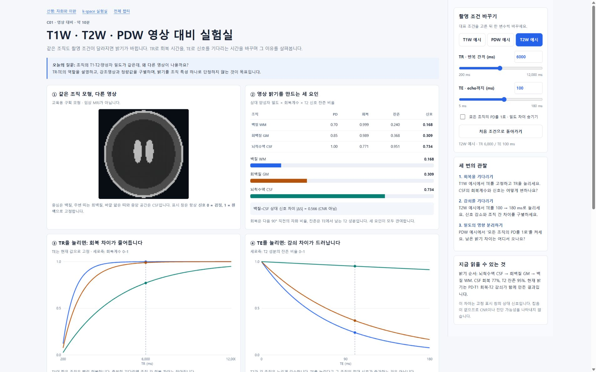
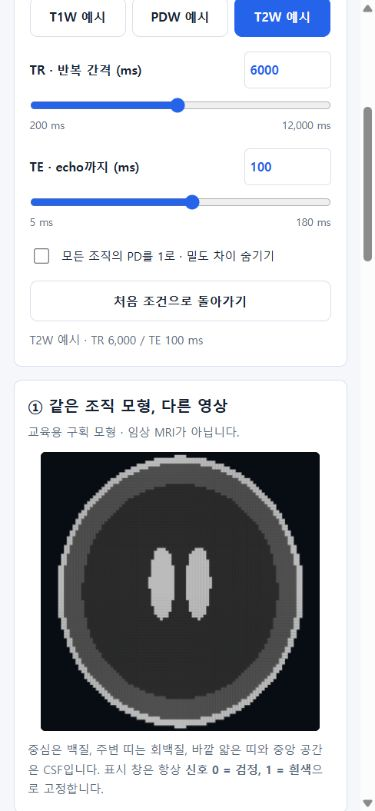

# C01 영상 대비 실험실 구현 검증

날짜: 2026-10-14 (Asia/Seoul)

대상: [contrast_weighting.html](../../contrast_weighting.html), [계산 모형](../../assets/contrast-model.js), [시험](../../../tests/contrast_weighting.test.cjs).

## 구현 범위

- T1W·T2W·PDW 대표 예시, TR·TE 슬라이더와 숫자 입력, PD 차이 제거, 초기화.
- 같은 계산 결과로 합성 구획 영상, 신호 표·막대, 회복·감쇠 곡선, 상대 신호 차이를 갱신한다.
- 영상 표시 창은 신호 0–1로 고정한다. 자동 밝기 정규화와 잡음은 포함하지 않는다.
- 기본 개념, 선행 수학·물리, 오개념, 세 관찰 과제, 확인 문제와 설명형 피드백, 추가 질문, 모형 범위와 근거를 포함한다.

## 과학·조작 검증

`node --test tests/*.test.cjs`: **24개 시험 통과** (새 C01 시험 5개 포함).

새 시험에서는 90° 직후 자화 → TE/2까지 회복 → 180°에서 종자화 반전 → 다음 90°까지 회복 순서로 독립적인 기준값을 계산해 기존 SE 정상상태 식과 비교했다. 조직 3개, TR 200/500/6000/12000 ms, TE 5/15/100/180 ms의 조합을 검산했다.

추가로 대표 영상의 밝기 순서, TE 증가 시 신호 감소, 긴 TR의 회복 증가, PD 차이 제거, 무한히 긴 TR/TE=0의 극한, slider 경계의 유한 신호, 숫자 입력·초기화·퀴즈 피드백, 로컬 자산·탐색 링크를 확인했다. Canvas stub 시험은 화면 검증과 구별한다.

## 실제 브라우저 확인

URL: `http://127.0.0.1:8765/contrast_weighting.html`

- **1920 × 1080 및 1920 × 1200:** 합성 영상·신호 표·곡선·오른쪽 조작 패널의 렌더링 확인. 문서 가로 폭과 viewport의 가용 폭이 같아 가로 overflow가 없었다.
- **390 × 844:** 조작 패널이 영상 위로 이동하고 단일 열로 렌더링됨. 신호 표와 canvas의 너비가 화면 안에 들어오는 것을 확인했다.
- T2W/PDW 선택, TE 180/TR 12000 직접 입력의 즉시 반영, PD switch, 정답 피드백, 초기화, slider Home/End 경계(TR 200/TE 180)를 실제 브라우저에서 확인했다.
- 숫자 입력이 바로 반영되지 않는 문제를 발견해 input/blur 처리를 수정했다. 입력 중인 숫자를 덮어쓰지 않고 유효 값은 즉시 반영하며, 범위 밖 값은 입력 완료 시 보정한다.
- 모바일 조작 패널이 설명 뒤에 놓인 초기 배치를 수정했다. resize 시 동일한 조작 요소를 옮겨 상태·이벤트를 보존한다.
- 확인한 브라우저 console에서 warning/error가 없었다.
- 검증용 viewport override는 마지막에 해제했다.

## 남은 범위

조직값은 교육용 예시이다. 실제 환자 MRI, 질병·병변 모형, 임상 정상값 표, noise·SNR, T2*, flow, 코일 효과, 지방억제, mapping은 미포함이다. 외부 전문가의 내용 검토는 아직 시행하지 않았다. 후속 구현은 [학습 로드맵](../../learning-roadmap.md)에 기록한다.
