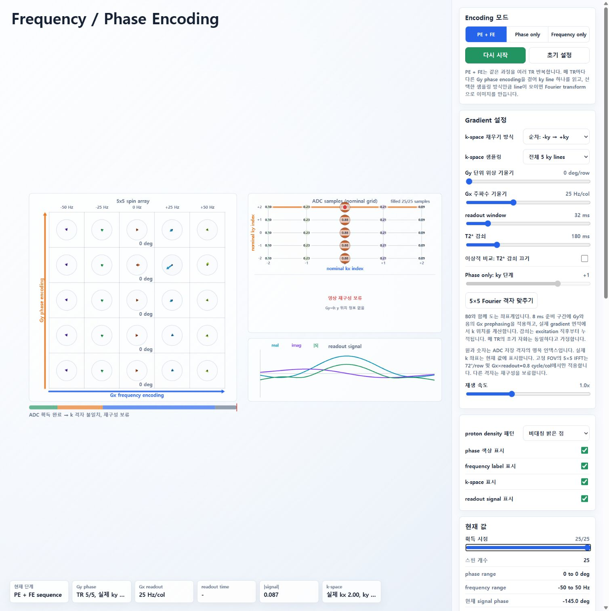
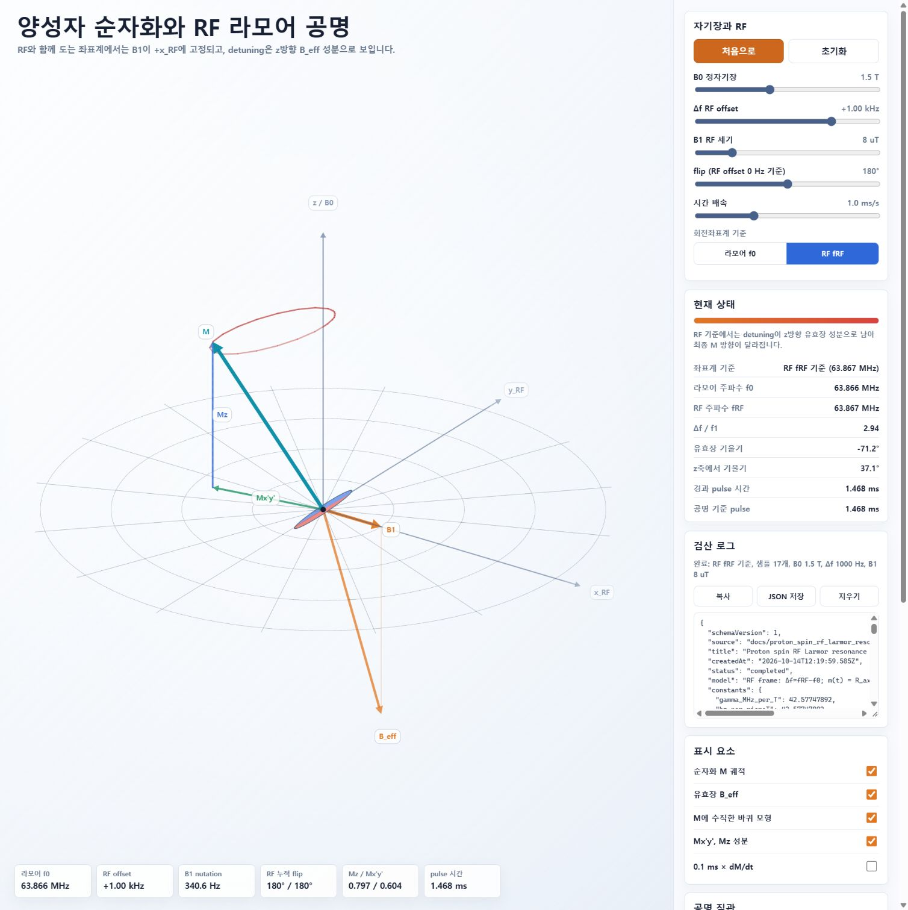
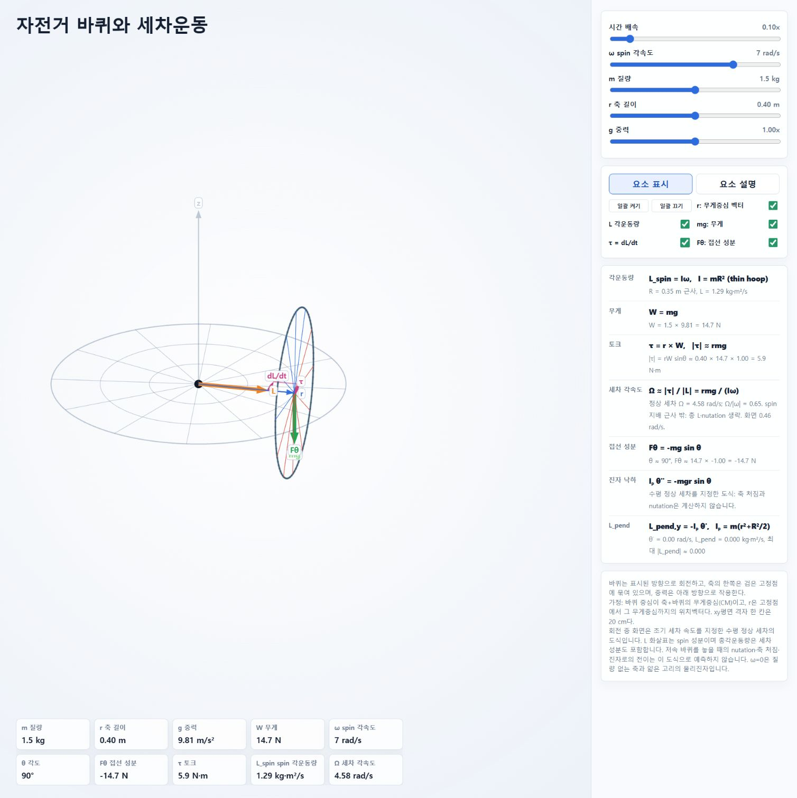

# 2026-10-14 수정 후 과학 검산

수정 전 보고서는 원본 커밋 `0006c3b`의 감사 기록으로 보존했습니다. 아래는 그 결과에 따라 바꾼 구현과 검산입니다. 교육용 모델의 가정까지 모두 제거한 실제 장비 모델이라는 의미는 아닙니다.

| 원본 보고서 항목 | 수정 상태 |
|---|---|
| 1·2. 신호–k-space 분리, 시작 kx 불일치 | 수정. 표시 신호와 ADC 저장값이 동일한 함수에서 계산됨. 음의 Gx prephasing 포함 |
| 3. RF offset 부호 | 수정. Δf=fRF−f0일 때 유효장 z성분 및 라머계 변환 부호를 함께 교정. b_eff 문서도 일치시킴 |
| 4. Spin echo | 수정. 각 isochromat에 실제 180° 회전을 적용하고, 이후 원래 Δf를 유지함. 합성 자화의 echo 재형성 표시 |
| 5. TE의 4 ms 차이 | 수정. 순간 pulse의 excitation 중심을 t=0으로 두고 refocusing=TE/2, echo/readout=TE |
| 6. Chemical signal 정규화 | 수정. 현재 신호와 TE 예측값을 동일한 water/fat 벡터 합 및 M0 기준으로 계산 |
| 7. RF 중 detuning | 수정. 자유 RF는 detuning 및 RF 중 T1/T2를 포함한 Bloch 회전 사용 |
| 8. 복소 역변환 허수부 누락 | 수정. 복소 IFFT를 보존하고 magnitude=√(real²+imag²)로 표시 |
| 9. 바퀴 정상 세차의 적용 범위 | 설명 보완. L_spin과 총 L을 구분하고, 저속의 실제 놓아주기·nutation을 예측하지 않는 도식임을 표시 |
| 10. 진자 관성과 반지름 축척 | 수정. 얇은 고리의 Iₚ=m(r²+R²/2), 그림에도 동일한 R=0.35 m 적용 |
| 11. 음수 Mxy 및 현재 flip | 수정. Mxy 크기는 비음수. 실제 z축 기울기를 계산하여 RF 누적각과 구분 |
| 12. 재생 배율 | 수정. clamp를 적용한 유효 RF 배율 표시. 시퀀스의 순간 pulse 가정을 설명 |
| 13. 기호·도식 | γ̄/γ 구분, RF OFF 표시, voxel/isochromat 의미, Phase only ky 선택, single-peak fat 가정 표시 |

**공간 부호화의 범위**

신호는 실제 k 위치와 excitation 이후의 T2* 감쇠를 포함해 계산합니다. 기본 조건은 5×5 Fourier 격자에 맞는 Gy=72°/row, Gx=25 Hz/col, readout=32 ms입니다. 준비 구간은 8 ms이고 readout의 kx는 −2부터 +2까지 움직입니다.

Gradient 값을 바꾸면 실제 k 좌표와 신호도 바뀝니다. 이 예제는 고정 FOV의 Cartesian IFFT를 가르치므로 격자가 맞지 않으면 재구성을 보류하고 이유를 표시합니다. Gy=0에서는 y 정보가 없다는 메시지를 표시하며 2D 영상을 만들어 내지 않습니다. 임의의 비균일 k 궤적을 재구성하는 NUFFT는 구현하지 않았습니다.

T2*를 끄는 이상적 비교에서 전체 샘플은 원본 밀도 패턴을 복원합니다. 감쇠가 켜지면 K의 크기와 재구성도 달라집니다. 일부 샘플만 얻으면 zero-filled 복소 역변환을 표시합니다. Partial Fourier 옵션은 누락된 한쪽 데이터를 고급 알고리즘으로 복원하는 기능이 아닙니다.

**MR 시퀀스의 범위**

자유 RF의 Δf는 fspin−fRF입니다. 유한 RF pulse는 detuning과 이완을 포함하고, pulse가 끝난 자화를 그대로 자유 세차의 초기값으로 넘깁니다. 양성자의 양의 γ 및 오른손 좌표계에서 dM/dt=γM×B를 사용합니다.

SE와 chemical 시퀀스는 이상적인 순간 pulse를 사용합니다. B1·RF 속도·목표각은 자유 RF에 적용됩니다. SE는 9개 가중 isochromat으로 정적 B0 분포를 근사하며, TR 직전 잔여 횡자화가 spoiling된 정상상태를 가정합니다. 180° pulse에 의한 T1 회복 자화의 반전도 포함했습니다.

Water/fat은 동일한 T1/T2와 3.5 ppm 단일 fat peak의 위상 간섭 모델입니다. 지방 다중 peak 및 공간적 chemical shift displacement는 다루지 않습니다.

**수치 및 실행 시험**

`node --test tests/physics-scientific.test.cjs`의 12개 시험을 통과했습니다.

[수정 후 수치 결과 JSON](corrected-results.json)은 `node scripts/collect-validation-results.cjs`로 재현할 수 있습니다. 원본 감사 수치와 구분해 보존합니다.

- 네 HTML의 초기화와 canvas 계산: 1400 px 및 390 px 폭, DPR=2에서 유한 좌표 확인.
- RF offset −1000/0/+1000 Hz, 90°/180°/360°: 독립 시간 의존 Bloch RK4 적분과 RF/라머 좌표계 결과 비교.
- 유한 RF detuning 및 이완: 독립 Bloch 적분과 비교, pulse 후 자유 세차의 자화 연속성 확인.
- 180° pulse에서 Mz·횡성분 반전, 각 Δf 유지, TE에서 합성 자화 재형성 및 정상상태 확인.
- Chemical TE=2.3 ms: 같은 시점의 현재 신호와 TE 예측값, 동일 M0 정규화 확인.
- 시퀀스 관찰 시점 slider로 정확한 TE를 지정하고, 일시정지 중 물리 시간이 유지되는지 확인.
- 270° 후 비음수 Mxy, 이완 중 실제 기울기 변화, 유효 재생 배율 확인.
- Gradient와 T2* 여러 조건에서 모든 ADC 샘플과 화면 복소 신호의 일치 확인.
- Gy=0에서 y 정보 상실 및 영상 재구성 보류 확인.
- 다섯 밀도 패턴의 이상적 Fourier 왕복, T2*의 데이터 영향, 부분 샘플링의 허수부 보존 확인.
- 얇은 고리 물리진자의 관성·에너지 보존 및 DPR에 독립적인 카메라 좌표 확인.
- 게시할 보고서 3개와 시뮬레이션의 로컬 링크·스크립트·이미지 파일 존재 확인.

자동 시험의 canvas 검산은 실제 브라우저의 글자 배치나 가독성을 증명하지 않습니다.

**게시 후 브라우저 점검**

2026-10-14에 GitHub Pages 배포 성공을 확인하고 실제 Chrome 페이지를 점검했습니다. GitHub의 Markdown Preview와 웹 보고서에서 표·문헌 링크·보고서 탐색이 렌더링되는 것을 확인했습니다.

- 공간 부호화: Gy=0, 비대칭 밝은 점, 획득 완료 시 실제 ky=0이며 “Gy=0: y 정보 없음 / 영상 재구성 보류” 표시 확인.
- RF 공명: Δf=fRF−f0=+1000 Hz, B1=8 µT, 180°에서 유효축 z=−0.946594, 최종 M=(−0.595044,−0.101043,+0.797316)인 완료 로그 확인.
- MR: 현재 z축 기울기, 현재 |S|/M0, TE 예측 |S|/M0, 순간 pulse 및 isochromat 가정이 표시되는 것을 확인. TE를 정밀하게 관찰할 slider와 일시정지 기능을 추가했습니다.
- 자전거 바퀴: 동일한 반지름 축척, L_spin 지표, 정상 세차의 적용 범위, 고리의 물리진자 식 확인.
- RF 공명·공간 부호화·바퀴 페이지에서 console error 없음 확인.

